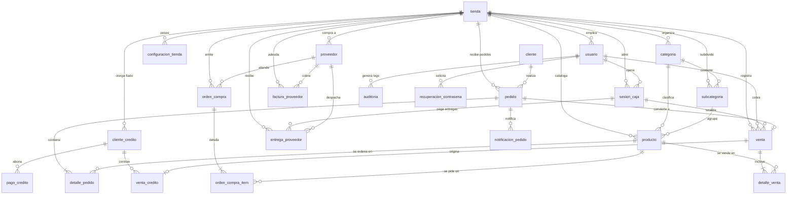

# Diccionario de Datos — MercAPP POS (28 Tablas)

> [!NOTE]
> Estructura completa de las **28 tablas relacionales** del sistema MercAPP POS con sus tipos de datos, llaves primarias (PK), foráneas (FK), restricciones y descripción funcional detallada. Verificado contra la base de datos `mercapp.db` y modelos SQLAlchemy 2.0.

---

## 🏪 1. Store (`tienda`)
**Descripción:** Entidad raíz del modelo multi-tenant. Representa un negocio o supermercado registrado.

| Campo | Tipo | Restricción | Descripción |
|-------|------|-------------|-------------|
| `id` | INTEGER | PK | Identificador único de la tienda |
| `name` | VARCHAR(100) | NOT NULL | Nombre comercial de la tienda |
| `created_at` | DATETIME | DEFAULT now() | Fecha y hora de registro |
| `is_active` | BOOLEAN | DEFAULT True | Estado operativo de la tienda |

---

## ⚙️ 2. StoreSettings (`configuracion_tienda`)
**Descripción:** Parámetros operativos, fiscales DIAN, hardware (impresoras/básculas) y personalización visual.

| Campo | Tipo | Restricción | Descripción |
|-------|------|-------------|-------------|
| `id` | INTEGER | PK | Identificador único |
| `store_id` | INTEGER | FK → `tienda.id`, NOT NULL | Tienda asociada |
| `store_name` | VARCHAR(100) | DEFAULT 'MercAPP' | Nombre para tickets y reportes |
| `logo` | VARCHAR(200) | DEFAULT 'logo.png' | Ruta del logo institucional |
| `qr_transferencia` | VARCHAR(200) | DEFAULT '' | Ruta del código QR de pagos bancarios |
| `razon_social` | VARCHAR(200) | DEFAULT 'MercAPP S.A.S' | Razón social legal |
| `nit` | VARCHAR(20) | DEFAULT '000.000.000-0' | NIT tributario |
| `rut` | VARCHAR(30) | DEFAULT '' | Número de RUT |
| `regimen_tributario` | VARCHAR(100) | DEFAULT 'No responsable de IVA' | Régimen tributario aplicable |
| `gran_contribuyente` | VARCHAR(100) | DEFAULT '' | Resolución DIAN gran contribuyente |
| `agente_retencion` | VARCHAR(100) | DEFAULT '' | Resolución agente retenedor |
| `direccion` | VARCHAR(200) | DEFAULT '' | Dirección física del establecimiento |
| `telefono` | VARCHAR(20) | DEFAULT '' | Teléfono de contacto comercial |
| `ciudad` | VARCHAR(100) | DEFAULT '' | Ciudad y departamento |
| `resolucion_dian` | VARCHAR(100) | DEFAULT '' | Número de resolución DIAN |
| `resolucion_fecha` | VARCHAR(50) | DEFAULT '' | Fecha de vigencia DIAN |
| `rango_desde` | VARCHAR(30) | DEFAULT 'MRC-0001' | Prefijo y consecutivo inicial |
| `rango_hasta` | VARCHAR(30) | DEFAULT 'MRC-9999' | Prefijo y consecutivo final |
| `mensaje_ticket` | VARCHAR(200) | DEFAULT '¡Gracias por su compra!' | Pie de página del ticket |
| `scale_mode` | VARCHAR(10) | DEFAULT 'manual' | Modo de pesaje: `manual` o `auto` |
| `printer_name` | VARCHAR(200) | DEFAULT '' | Nombre de la impresora térmica en Windows |
| `auto_print` | BOOLEAN | DEFAULT True | Impresión automática al cobrar |
| `auto_drawer` | BOOLEAN | DEFAULT True | Disparo automático del cajón de dinero |
| `theme_color_primary` | VARCHAR(20) | DEFAULT 'default' | Color primario de interfaz |
| `theme_color_accent` | VARCHAR(20) | DEFAULT 'default' | Color de acento |
| `theme_color_background` | VARCHAR(20) | DEFAULT 'default' | Fondo general |
| `theme_font_family` | VARCHAR(50) | DEFAULT 'default' | Tipografía de UI |
| `theme_font_size` | VARCHAR(15) | DEFAULT 'default' | Escala de fuente |
| `theme_btn_clear_color` | VARCHAR(20) | DEFAULT 'default' | Estilo botón limpiar |
| `theme_btn_charge_color` | VARCHAR(20) | DEFAULT 'default' | Estilo botón cobrar |

---

## 👤 3. User (`usuario`)
**Descripción:** Usuarios del sistema administrativo y operativo (Administrador y Cajero) con control de acceso y seguridad.

| Campo | Tipo | Restricción | Descripción |
|-------|------|-------------|-------------|
| `id` | INTEGER | PK | Identificador único |
| `store_id` | INTEGER | FK → `tienda.id`, NOT NULL | Tienda a la que pertenece |
| `name` | VARCHAR(100) | NOT NULL | Nombre y apellidos completos |
| `username` | VARCHAR(50) | NULL | Alias o usuario corto opcional |
| `email` | VARCHAR(120) | UNIQUE, NOT NULL | Correo para inicio de sesión |
| `password_hash` | VARCHAR(255) | NOT NULL | Hash scrypt/PBKDF2 de la clave |
| `is_admin` | BOOLEAN | DEFAULT True | Rol: Administrador (`True`) o Cajero (`False`) |
| `is_active_cashier` | BOOLEAN | DEFAULT True | Permiso operativo para abrir caja |
| `status` | VARCHAR(20) | DEFAULT 'ACTIVO' | Estado: `ACTIVO` o `BLOQUEADO` |
| `failed_attempts` | INTEGER | DEFAULT 0 | Contador de intentos fallidos consecutivos |
| `locked_until` | DATETIME | NULL | Timestamp hasta el cual la cuenta está suspendida (15 min) |
| `last_login` | DATETIME | NULL | Última fecha y hora de sesión exitosa |
| `created_at` | DATETIME | DEFAULT now() | Fecha de registro |

---

## 🛍️ 4. Customer (`cliente`)
**Descripción:** Clientes finales que compran en el Storefront Online (E-Commerce).

| Campo | Tipo | Restricción | Descripción |
|-------|------|-------------|-------------|
| `id` | INTEGER | PK | Identificador único |
| `name` | VARCHAR(100) | NULL | Nombre completo del comprador |
| `email` | VARCHAR(100) | UNIQUE, NULL | Correo para login en tienda web |
| `phone` | VARCHAR(20) | NULL | Teléfono móvil para avisos |
| `address` | VARCHAR(200) | NULL | Dirección predeterminada de entrega |
| `password_hash` | VARCHAR(255) | NULL | Hash de la contraseña del cliente |
| `created_at` | DATETIME | DEFAULT now() | Fecha de registro en el storefront |

---

## 📂 5. Category (`categoria`)
**Descripción:** Categorías principales de productos en el catálogo comercial.

| Campo | Tipo | Restricción | Descripción |
|-------|------|-------------|-------------|
| `id` | INTEGER | PK | Identificador único |
| `store_id` | INTEGER | FK → `tienda.id`, NOT NULL | Tienda propietaria |
| `name` | VARCHAR(50) | NOT NULL | Nombre de la categoría (ej. Lácteos) |
| `slug` | VARCHAR(50) | NOT NULL | Slug amigable para URLs |
| `image` | VARCHAR(200) | DEFAULT 'default_category.png' | Icono o imagen ilustrativa |
| `description` | VARCHAR(200) | NULL | Descripción comercial |
| `display_order` | INTEGER | DEFAULT 0 | Orden de aparición en botones POS |
| `visible_in_pos` | BOOLEAN | DEFAULT True | Si es visible en la cuadrícula de ventas |

---

## 📑 6. Subcategory (`subcategoria`)
**Descripción:** Subcategorías para clasificación fina de productos.

| Campo | Tipo | Restricción | Descripción |
|-------|------|-------------|-------------|
| `id` | INTEGER | PK | Identificador único |
| `store_id` | INTEGER | FK → `tienda.id`, NOT NULL | Tienda propietaria |
| `category_id` | INTEGER | FK → `categoria.id`, NOT NULL | Categoría padre |
| `name` | VARCHAR(50) | NOT NULL | Nombre de la subcategoría |
| `slug` | VARCHAR(50) | NOT NULL | Slug identificador |
| `image` | VARCHAR(200) | DEFAULT 'default_subcategory.png' | Imagen opcional |
| `display_order` | INTEGER | DEFAULT 0 | Posición en menú |

---

## 📦 7. Product (`producto`)
**Descripción:** Catálogo maestro de artículos para venta por código de barras o balanza de peso.

| Campo | Tipo | Restricción | Descripción |
|-------|------|-------------|-------------|
| `id` | INTEGER | PK | Identificador único |
| `store_id` | INTEGER | FK → `tienda.id`, NOT NULL | Tienda propietaria |
| `category_id` | INTEGER | FK → `categoria.id`, NOT NULL | Categoría asociada |
| `subcategory_id` | INTEGER | FK → `subcategoria.id`, NULL | Subcategoría opcional |
| `name` | VARCHAR(150) | NOT NULL | Nombre y presentación del producto |
| `barcode` | VARCHAR(60) | NULL | Código de barras EAN-13 o manual |
| `has_barcode` | BOOLEAN | DEFAULT False | Si utiliza lector o búsqueda rápida |
| `price` | INTEGER | NOT NULL | Precio de venta en pesos colombianos (COP) |
| `image` | VARCHAR(200) | DEFAULT 'default_product.png' | Imagen del producto |
| `stock` | INTEGER | NULL | Cantidad de unidades o gramos disponibles |
| `sell_by_weight` | BOOLEAN | DEFAULT False | Flag para productos pesables en balanza |
| `weight_unit` | VARCHAR(5) | DEFAULT 'kg' | Unidad de peso (`kg`, `g`, `lb`) |
| `plu_code` | VARCHAR(60) | NULL | Código PLU de balanza para frutas/verduras |
| `sale_count` | INTEGER | DEFAULT 0 | Métricas de ventas acumuladas |
| `is_active` | BOOLEAN | DEFAULT True | Estado activo/desactivado |
| `created_at` | DATETIME | DEFAULT now() | Fecha de alta en inventario |

---

## 💵 8. CashSession (`sesion_caja`)
**Descripción:** Turnos de caja. Control de apertura, base inicial, arqueo y cierre diario.

| Campo | Tipo | Restricción | Descripción |
|-------|------|-------------|-------------|
| `id` | INTEGER | PK | Identificador de la sesión de caja |
| `store_id` | INTEGER | FK → `tienda.id`, NOT NULL | Tienda |
| `user_id` | INTEGER | FK → `usuario.id`, NOT NULL | Cajero responsable del turno |
| `opened_at` | DATETIME | DEFAULT now() | Fecha y hora de apertura |
| `closed_at` | DATETIME | NULL | Fecha y hora de cierre del turno |
| `base_amount` | INTEGER | DEFAULT 0 | Dinero base en caja al iniciar |
| `cash_sales` | INTEGER | DEFAULT 0 | Total ventas en efectivo |
| `card_sales` | INTEGER | DEFAULT 0 | Total ventas con tarjeta |
| `transfer_sales` | INTEGER | DEFAULT 0 | Total ventas transferencia (Nequi/Daviplata) |
| `expected_cash` | INTEGER | DEFAULT 0 | Efectivo teórico esperado (base + ventas - pagos) |
| `actual_cash` | INTEGER | NULL | Efectivo real contado en el arqueo físico |
| `status` | VARCHAR(20) | DEFAULT 'abierta' | Estado: `abierta` o `cerrada` |

---

## 🧾 9. Sale (`venta`)
**Descripción:** Cabecera de la transacción de venta registrada en POS o convertida desde pedido online.

| Campo | Tipo | Restricción | Descripción |
|-------|------|-------------|-------------|
| `id` | INTEGER | PK | Identificador de la venta |
| `store_id` | INTEGER | FK → `tienda.id`, NOT NULL | Tienda |
| `cash_session_id` | INTEGER | FK → `sesion_caja.id`, NULL | Turno de caja en que ocurrió |
| `credit_client_id` | INTEGER | FK → `cliente_credito.id`, NULL | Cliente de crédito si aplica ("fiado") |
| `user_id` | INTEGER | FK → `usuario.id`, NOT NULL | Cajero que ejecutó el cobro |
| `receipt_number` | VARCHAR(30) | NOT NULL | Número de consecutivo de ticket (ej. MRC-0042) |
| `sale_date` | DATETIME | DEFAULT now() | Fecha y hora exacta de la compra |
| `subtotal` | INTEGER | NOT NULL | Subtotal antes de impuestos/ajustes |
| `total` | INTEGER | NOT NULL | Valor total pagado |
| `payment_method` | VARCHAR(20) | NOT NULL | Medio: `efectivo`, `tarjeta`, `transferencia`, `credito`, `mixto` |
| `amount_received` | INTEGER | DEFAULT 0 | Dinero entregado por el cliente |
| `change_given` | INTEGER | DEFAULT 0 | Cambio o devuelta entregada |
| `payment_ref` | VARCHAR(100) | NULL | Referencia de transacción bancaria |
| `amount_cash` | INTEGER | DEFAULT 0 | Porción en efectivo (pago mixto) |
| `amount_card` | INTEGER | DEFAULT 0 | Porción en tarjeta (pago mixto) |
| `amount_transfer` | INTEGER | DEFAULT 0 | Porción por transferencia (pago mixto) |
| `status` | VARCHAR(20) | DEFAULT 'completada' | Estado: `completada` o `anulada` |

---

## 🛒 10. SaleItem (`detalle_venta`)
**Descripción:** Renglones o ítems incluidos en cada ticket de venta.

| Campo | Tipo | Restricción | Descripción |
|-------|------|-------------|-------------|
| `id` | INTEGER | PK | Identificador del renglón |
| `sale_id` | INTEGER | FK → `venta.id`, NOT NULL | Venta asociada |
| `product_id` | INTEGER | FK → `producto.id`, NOT NULL | Producto vendido |
| `quantity` | INTEGER | NOT NULL | Unidades vendidas (o 1 si es por peso) |
| `unit_price` | INTEGER | NOT NULL | Precio unitario al momento de venta |
| `subtotal` | INTEGER | NOT NULL | Total del ítem (`quantity` × `unit_price`) |
| `weight_grams` | INTEGER | NULL | Gramos exactos en caso de producto de báscula |
| `weight_unit` | VARCHAR(5) | NULL | Unidad de medida (`kg`, `g`, `lb`) |

---

## 👥 11. CreditClient (`cliente_credito`)
**Descripción:** Clientes de crédito local ("clientes de confianza" / libreta de fiado).

| Campo | Tipo | Restricción | Descripción |
|-------|------|-------------|-------------|
| `id` | INTEGER | PK | Identificador único |
| `store_id` | INTEGER | FK → `tienda.id`, NOT NULL | Tienda |
| `name` | VARCHAR(100) | NOT NULL | Nombre completo del cliente de crédito |
| `phone` | VARCHAR(20) | NULL | Teléfono para cobranza y WhatsApp |
| `email` | VARCHAR(120) | NULL | Correo de contacto |
| `is_active` | BOOLEAN | DEFAULT True | Estado activo para otorgar nuevo crédito |
| `created_at` | DATETIME | DEFAULT now() | Fecha de registro |

---

## 💳 12. CreditSale (`venta_credito`)
**Descripción:** Obligación de deuda generada cuando una venta se factura a crédito ("fiado").

| Campo | Tipo | Restricción | Descripción |
|-------|------|-------------|-------------|
| `id` | INTEGER | PK | Identificador único del crédito |
| `client_id` | INTEGER | FK → `cliente_credito.id`, NOT NULL | Cliente deudor |
| `sale_id` | INTEGER | FK → `venta.id`, NOT NULL | Venta de origen |
| `amount` | INTEGER | NOT NULL | Monto total adeudado inicialmente |
| `balance` | INTEGER | NOT NULL | Saldo pendiente por pagar |
| `status` | VARCHAR(20) | DEFAULT 'pendiente' | Estado: `pendiente`, `parcial`, `pagada` |
| `created_at` | DATETIME | DEFAULT now() | Fecha de concesión del crédito |

---

## 💰 13. CreditPayment (`pago_credito`)
**Descripción:** Abonos y cancelaciones realizados por un cliente a su cartera de crédito.

| Campo | Tipo | Restricción | Descripción |
|-------|------|-------------|-------------|
| `id` | INTEGER | PK | Identificador del abono |
| `client_id` | INTEGER | FK → `cliente_credito.id`, NOT NULL | Cliente que abona |
| `amount` | INTEGER | NOT NULL | Valor del abono en COP |
| `payment_method` | VARCHAR(20) | DEFAULT 'efectivo' | Medio: `efectivo`, `transferencia`, `tarjeta` |
| `payment_date` | DATETIME | DEFAULT now() | Fecha y hora del abono |
| `notes` | VARCHAR(200) | NULL | Observaciones o recibo físico |

---

## 🚚 14. Supplier (`proveedor`)
**Descripción:** Proveedores comerciales y distribuidores con acceso opcional al portal de proveedores.

| Campo | Tipo | Restricción | Descripción |
|-------|------|-------------|-------------|
| `id` | INTEGER | PK | Identificador único |
| `store_id` | INTEGER | FK → `tienda.id`, NULL | Tienda asociada |
| `company_name` | VARCHAR(150) | NOT NULL | Razón social de la empresa proveedora |
| `contact_name` | VARCHAR(100) | NULL | Nombre del asesor comercial o despachador |
| `nit` | VARCHAR(30) | NULL | NIT o cédula jurídica |
| `email` | VARCHAR(120) | NOT NULL | Correo para login en portal y facturación |
| `phone` | VARCHAR(30) | NULL | Teléfono o celular de contacto |
| `address` | VARCHAR(200) | NULL | Dirección del centro de distribución |
| `category_type` | VARCHAR(100) | DEFAULT 'General' | Rubro (Bebidas, Cárnicos, Abarrotes, etc.) |
| `payment_terms_days` | INTEGER | DEFAULT 30 | Días de plazo de pago acordados |
| `credit_limit` | INTEGER | DEFAULT 10000000 | Límite de cupo de crédito otorgado al negocio |
| `total_debt` | INTEGER | DEFAULT 0 | Saldo adeudado acumulado al proveedor |
| `password_hash` | VARCHAR(255) | NULL | Clave encriptada para login de proveedor |
| `status` | VARCHAR(20) | DEFAULT 'ACTIVO' | Estado: `ACTIVO` o `SUSPENDIDO` |
| `created_at` | DATETIME | DEFAULT now() | Fecha de alta |

---

## 📋 15. PurchaseOrder (`orden_compra`)
**Descripción:** Órdenes de abastecimiento emitidas por la tienda a un proveedor específico.

| Campo | Tipo | Restricción | Descripción |
|-------|------|-------------|-------------|
| `id` | INTEGER | PK | Identificador único de orden |
| `store_id` | INTEGER | FK → `tienda.id`, NOT NULL | Tienda emisora |
| `supplier_id` | INTEGER | FK → `proveedor.id`, NOT NULL | Proveedor destinatario |
| `order_number` | VARCHAR(50) | NOT NULL | Consecutivo de orden (ej. OC-2026-001) |
| `status` | VARCHAR(30) | DEFAULT 'PENDIENTE' | Estado: `PENDIENTE`, `APROBADA`, `RECIBIDA`, `CANCELADA` |
| `total_estimated` | INTEGER | DEFAULT 0 | Costo estimado total de la compra |
| `notes` | TEXT | NULL | Instrucciones especiales de despacho |
| `expected_delivery` | DATETIME | NULL | Fecha programada de arribo |
| `created_at` | DATETIME | DEFAULT now() | Fecha de expedición |

---

## 📦 16. PurchaseOrderItem (`orden_compra_item`)
**Descripción:** Artículos y cantidades solicitadas en una orden de compra.

| Campo | Tipo | Restricción | Descripción |
|-------|------|-------------|-------------|
| `id` | INTEGER | PK | Identificador del ítem |
| `order_id` | INTEGER | FK → `orden_compra.id`, NOT NULL | Orden de compra asociada |
| `product_id` | INTEGER | FK → `producto.id`, NULL | Producto del catálogo si existe |
| `product_name` | VARCHAR(150) | NOT NULL | Nombre del producto |
| `quantity_ordered` | INTEGER | DEFAULT 1 | Cantidad pedida |
| `quantity_received` | INTEGER | DEFAULT 0 | Cantidad físicamente recibida en almacén |
| `unit_cost` | INTEGER | DEFAULT 0 | Costo unitario acordado |
| `subtotal` | INTEGER | DEFAULT 0 | Total renglón (`quantity_ordered` × `unit_cost`) |

---

## 📄 17. SupplierInvoice (`factura_proveedor`)
**Descripción:** Facturas comerciales por cobrar recibidas de los distribuidores mayoristas.

| Campo | Tipo | Restricción | Descripción |
|-------|------|-------------|-------------|
| `id` | INTEGER | PK | Identificador único |
| `store_id` | INTEGER | FK → `tienda.id`, NOT NULL | Tienda deudora |
| `supplier_id` | INTEGER | FK → `proveedor.id`, NOT NULL | Proveedor emisor |
| `invoice_number` | VARCHAR(50) | NOT NULL | Número de factura del proveedor |
| `issue_date` | DATETIME | DEFAULT now() | Fecha de expedición |
| `due_date` | DATETIME | NOT NULL | Fecha límite de pago de la factura |
| `total_amount` | INTEGER | NOT NULL | Monto total a pagar |
| `paid_amount` | INTEGER | DEFAULT 0 | Monto abonado o cancelado |
| `status` | VARCHAR(30) | DEFAULT 'PENDIENTE' | Estado: `PENDIENTE`, `PAGADA_PARCIAL`, `PAGADA` |
| `notes` | TEXT | NULL | Notas adicionales de pago |
| `created_at` | DATETIME | DEFAULT now() | Fecha de registro en el sistema |

---

## 🚛 18. SupplierDelivery (`entrega_proveedor`)
**Descripción:** Despachos físicos y pagos inmediatos en caja realizados a proveedores en tienda.

| Campo | Tipo | Restricción | Descripción |
|-------|------|-------------|-------------|
| `id` | INTEGER | PK | Identificador de la entrega |
| `supplier_id` | INTEGER | FK → `proveedor.id`, NOT NULL | Proveedor que entrega mercancía |
| `store_id` | INTEGER | FK → `tienda.id`, NOT NULL | Tienda |
| `cash_session_id` | INTEGER | FK → `sesion_caja.id`, NULL | Turno de caja si se pagó con dinero de caja |
| `order_number` | VARCHAR(60) | NOT NULL | Consecutivo o remisión |
| `delivery_date` | DATETIME | DEFAULT now() | Fecha y hora de recepción |
| `total_amount` | INTEGER | NOT NULL | Valor cancelado en la entrega |
| `payment_method` | VARCHAR(30) | DEFAULT 'efectivo_caja' | Medio de desembolso |
| `amount_cash` | INTEGER | DEFAULT 0 | Valor pagado en efectivo |
| `amount_transfer` | INTEGER | DEFAULT 0 | Valor pagado por transferencia |
| `notes` | TEXT | NULL | Observaciones del cajero/almacenista |
| `invoice_photo` | VARCHAR(255) | NULL | Foto comprobante de la remisión física |
| `is_confirmed` | BOOLEAN | DEFAULT True | Confirmación de recibido |
| `confirmed_at` | DATETIME | DEFAULT now() | Timestamp de confirmación |
| `created_at` | DATETIME | DEFAULT now() | Registro de entrega |

---

## 🛍️ 19. Order (`pedido`)
**Descripción:** Pedidos en línea recibidos desde el catálogo virtual (storefront web).

| Campo | Tipo | Restricción | Descripción |
|-------|------|-------------|-------------|
| `id` | INTEGER | PK | Identificador del pedido |
| `store_id` | INTEGER | FK → `tienda.id`, NOT NULL | Tienda que recibe el pedido |
| `customer_id` | INTEGER | FK → `cliente.id`, NULL | Cliente registrado si aplica |
| `user_id` | INTEGER | FK → `usuario.id`, NULL | Empleado que despachó el pedido |
| `sale_id` | INTEGER | FK → `venta.id`, NULL | Venta generada cuando el pedido se factura en POS |
| `customer_name` | VARCHAR(100) | NOT NULL | Nombre de quien recibe |
| `customer_phone` | VARCHAR(20) | NOT NULL | Teléfono celular |
| `customer_address` | VARCHAR(200) | NULL | Dirección de entrega a domicilio |
| `order_type` | VARCHAR(20) | DEFAULT 'domicilio' | Modalidad: `domicilio` o `recoger_tienda` |
| `payment_method` | VARCHAR(20) | DEFAULT 'efectivo' | Pago previsto (`efectivo`, `transferencia`, `tarjeta`) |
| `delivery_cost` | INTEGER | DEFAULT 0 | Costo de envío a domicilio |
| `subtotal` | INTEGER | DEFAULT 0 | Valor de los productos |
| `total` | INTEGER | DEFAULT 0 | Total a cobrar (`subtotal` + `delivery_cost`) |
| `status` | VARCHAR(20) | DEFAULT 'pendiente' | Estado: `pendiente`, `en_preparacion`, `en_camino`, `entregado`, `cancelado` |
| `notes` | TEXT | NULL | Observaciones del cliente |
| `created_at` | DATETIME | DEFAULT now() | Fecha y hora en que se envió el pedido |

---

## 🛒 20. OrderItem (`detalle_pedido`)
**Descripción:** Productos y cantidades solicitadas en un pedido de la tienda virtual.

| Campo | Tipo | Restricción | Descripción |
|-------|------|-------------|-------------|
| `id` | INTEGER | PK | Identificador del ítem de pedido |
| `order_id` | INTEGER | FK → `pedido.id`, NOT NULL | Pedido asociado |
| `product_id` | INTEGER | FK → `producto.id`, NOT NULL | Producto ordenado |
| `quantity` | FLOAT | NOT NULL | Cantidad de unidades o peso |
| `unit_price` | INTEGER | NOT NULL | Precio pactado al enviar el pedido |
| `subtotal` | INTEGER | NOT NULL | Monto (`quantity` × `unit_price`) |
| `weight_grams` | INTEGER | NULL | Gramos calculados si es por peso |
| `weight_unit` | VARCHAR(5) | NULL | Unidad de medida (`kg`, `g`, `lb`) |

---

## 🔔 21. OrderNotification (`notificacion_pedido`)
**Descripción:** Mensajes y actualizaciones enviadas al cliente sobre el estado de su pedido.

| Campo | Tipo | Restricción | Descripción |
|-------|------|-------------|-------------|
| `id` | INTEGER | PK | Identificador de la notificación |
| `order_id` | INTEGER | FK → `pedido.id`, NOT NULL | Pedido relacionado |
| `message` | TEXT | NOT NULL | Contenido del mensaje |
| `is_read` | BOOLEAN | DEFAULT False | Si el cliente ya visualizó el aviso |
| `created_at` | DATETIME | DEFAULT now() | Timestamp de expedición |

---

## 🛡️ 22. AuditLog (`auditoria`)
**Descripción:** Bitácora inmutable de seguridad. Registra cada acción crítica, login, anulación y modificación.

| Campo | Tipo | Restricción | Descripción |
|-------|------|-------------|-------------|
| `id` | INTEGER | PK | Identificador del evento de auditoría |
| `user_id` | INTEGER | FK → `usuario.id`, NULL | Usuario responsable (o null si anónimo) |
| `action` | VARCHAR(50) | NOT NULL | Operación: `LOGIN`, `LOGOUT`, `VENTA`, `ANULACION`, `CREACION_PRODUCTO`, etc. |
| `description` | TEXT | NOT NULL | Resumen detallado del suceso con IDs |
| `ip_address` | VARCHAR(45) | DEFAULT '127.0.0.1' | Dirección IP cliente (soporta IPv4 e IPv6) |
| `severity` | VARCHAR(20) | DEFAULT 'INFO' | Nivel: `INFO`, `WARNING`, `CRITICAL` |
| `created_at` | DATETIME | DEFAULT now() | Marca temporal inmutable |

---

## 📬 23. EmailQueue (`cola_correos`)
**Descripción:** Cola persistente para envíos asíncronos de correo con soporte de reintentos y tolerancia a fallos.

| Campo | Tipo | Restricción | Descripción |
|-------|------|-------------|-------------|
| `id` | INTEGER | PK | Identificador del mensaje en cola |
| `store_id` | INTEGER | NULL | Tienda originaria |
| `recipient` | VARCHAR(150) | NOT NULL | Buzón destino del correo |
| `subject` | VARCHAR(200) | NOT NULL | Asunto del mensaje |
| `html_body` | TEXT | NOT NULL | Cuerpo HTML con estilos inline y logo |
| `email_type` | VARCHAR(50) | DEFAULT 'cierre_caja' | Tipo: `cierre_caja`, `verificacion`, `recuperacion`, `orden_compra` |
| `status` | VARCHAR(20) | DEFAULT 'pending' | Estado: `pending`, `sent`, `failed` |
| `attempts` | INTEGER | DEFAULT 0 | Contador de reintentos ejecutados |
| `last_error` | TEXT | NULL | Traza de error SMTP si falló |
| `created_at` | DATETIME | DEFAULT now() | Fecha de encolamiento |
| `sent_at` | DATETIME | NULL | Timestamp de confirmación de despacho |

---

## ✉️ 24. EmailVerification (`verificacion_email`)
**Descripción:** Códigos OTP de verificación para registro de nuevas tiendas y administradores.

| Campo | Tipo | Restricción | Descripción |
|-------|------|-------------|-------------|
| `id` | INTEGER | PK | Identificador único |
| `email` | VARCHAR(120) | NOT NULL | Correo a verificar |
| `code` | VARCHAR(10) | NOT NULL | Token OTP numérico |
| `store_name` | VARCHAR(100) | NOT NULL | Nombre de la tienda a dar de alta |
| `user_name` | VARCHAR(100) | NOT NULL | Nombre del administrador |
| `password_hash` | VARCHAR(256) | NOT NULL | Contraseña hasheada en espera de confirmación |
| `verified` | BOOLEAN | DEFAULT False | Bandera de éxito |
| `attempts` | INTEGER | DEFAULT 0 | Contador de intentos de validación |
| `expires_at` | DATETIME | NOT NULL | Fecha y hora de expiración (TTL 15 min) |
| `created_at` | DATETIME | DEFAULT now() | Fecha de solicitud |

---

## ✉️ 25. CustomerEmailVerification (`verificacion_email_cliente`)
**Descripción:** Validación de correo electrónico para nuevos clientes del storefront online.

| Campo | Tipo | Restricción | Descripción |
|-------|------|-------------|-------------|
| `id` | INTEGER | PK | Identificador único |
| `name` | VARCHAR(100) | NOT NULL | Nombre del cliente |
| `email` | VARCHAR(120) | NOT NULL | Correo a validar |
| `phone` | VARCHAR(20) | NOT NULL | Teléfono |
| `address` | VARCHAR(200) | NULL | Dirección opcional |
| `password_hash` | VARCHAR(256) | NOT NULL | Clave hasheada |
| `code` | VARCHAR(10) | NOT NULL | Código OTP de 6 dígitos |
| `verified` | BOOLEAN | DEFAULT False | Bandera de validación |
| `attempts` | INTEGER | DEFAULT 0 | Intentos errados |
| `expires_at` | DATETIME | NOT NULL | Expiración del código |
| `created_at` | DATETIME | DEFAULT now() | Creación |

---

## ✉️ 26. SupplierEmailVerification (`verificacion_email_proveedor`)
**Descripción:** Validación por correo para autorregistro de proveedores mayoristas en el portal.

| Campo | Tipo | Restricción | Descripción |
|-------|------|-------------|-------------|
| `id` | INTEGER | PK | Identificador único |
| `company_name` | VARCHAR(150) | NOT NULL | Empresa proveedora |
| `contact_name` | VARCHAR(100) | NOT NULL | Asesor comercial |
| `email` | VARCHAR(120) | NOT NULL | Correo corporativo |
| `phone` | VARCHAR(30) | NOT NULL | Teléfono |
| `password_hash` | VARCHAR(256) | NOT NULL | Clave segura |
| `code` | VARCHAR(10) | NOT NULL | Código OTP |
| `verified` | BOOLEAN | DEFAULT False | Estado de verificación |
| `attempts` | INTEGER | DEFAULT 0 | Intentos |
| `expires_at` | DATETIME | NOT NULL | Expiración |
| `created_at` | DATETIME | DEFAULT now() | Registro de emisión |

---

## 🔑 27. PasswordReset (`recuperacion_contrasena`)
**Descripción:** Tokens seguros con caducidad para el flujo de restablecimiento de contraseña olvidada.

| Campo | Tipo | Restricción | Descripción |
|-------|------|-------------|-------------|
| `id` | INTEGER | PK | Identificador único |
| `user_id` | INTEGER | FK → `usuario.id`, NOT NULL | Usuario que solicitó el restablecimiento |
| `token` | VARCHAR(100) | UNIQUE, NOT NULL | Token criptográfico unívoco de 64 caracteres |
| `expires_at` | DATETIME | NOT NULL | Expiración (1 hora) |
| `used` | BOOLEAN | DEFAULT False | Si el enlace ya fue consumido |
| `created_at` | DATETIME | DEFAULT now() | Fecha de generación |

---

## 🔐 28. AppLicense (`app_license`)
**Descripción:** Control de vigencia y expiración de licencia del software para instalación local o comercial.

| Campo | Tipo | Restricción | Descripción |
|-------|------|-------------|-------------|
| `id` | INTEGER | PK | Identificador único |
| `expiration_date` | DATETIME | NOT NULL | Fecha y hora en que expira la licencia comercial |
| `last_time_checked` | DATETIME | NULL | Timestamp del último chequeo contra reloj seguro |

---

## 📊 Matriz de Relaciones y Cardinalidades

