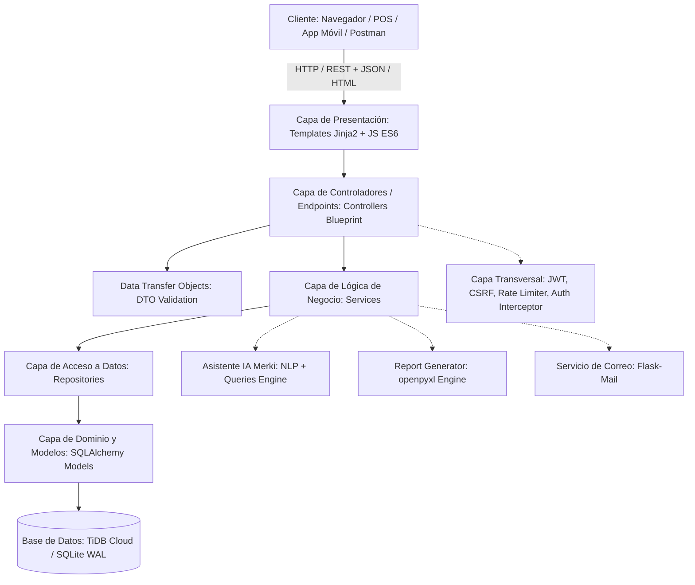
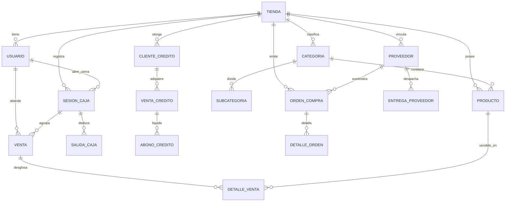

# MANUAL TÉCNICO DE ARQUITECTURA Y DESARROLLO — MercAPP POS
**Sistema Inteligente de Punto de Venta, Gestión de Inventario y Relación con Proveedores para Comercio Minorista**

---

## 1. Ficha Técnica del Proyecto

- **Nombre del Sistema:** MercAPP POS (Point of Sale & Retail Management System)
- **Versión:** 2.0.0 (Enterprise Academic Release)
- **Arquitectura de Software:** Monolito Modular Desacoplado por Capas (N-Tier / Layered Architecture) con soporte Híbrido Web & Desktop
- **Lenguaje Principal:** Python 3.11+ / Python 3.14
- **Framework Web Backend:** Flask 3.0+
- **ORM & Capa de Persistencia:** SQLAlchemy 2.0+ con Flask-SQLAlchemy
- **Motor de Base de Datos:**
  - *Nube / Producción:* TiDB Cloud Serverless (MySQL 8.0 Protocol Compatible con escalado horizontal)
  - *Local / Standalone:* SQLite 3 en modo concurrente Write-Ahead Logging (WAL)
- **Servidor Web WSGI:** Waitress (Multi-hilo concurrente optimizado para Windows Server / Linux)
- **Seguridad & Autenticación:** Flask-Login (Sesiones Web Stateful con cookies seguras HttpOnly/SameSite), PyJWT 2.8+ (Tokens Bearer Stateless para API desacoplada), Flask-WTF (Tokens CSRF sincrónicos y asincrónicos), Flask-Limiter (Rate Limiting).
- **Frontend:** HTML5 semántico, Jinja2 Templating Engine, CSS3 modular (soporte dinámico Dark/Light), JavaScript ES6+ Vanilla asíncrono (Fetch API sin dependencias pesadas), Bootstrap 5.3, JsBarcode.
- **Inteligencia Artificial:** Asistente Contextual NLP multi-tenant "Merki" (Procesamiento de Lenguaje Natural en Español, heurística predictiva y árbol de decisiones contextual).

---

## 2. Arquitectura de Software por Capas (N-Tier)

MercAPP implementa una separación estricta de responsabilidades inspirada en los principios de diseño SOLID y arquitectura empresarial:

### 2.1. Desglose de Capas

1. **Capa de Controladores (`controllers/`):**
   - Responsable únicamente de enrutar las solicitudes HTTP, extraer y tipar parámetros, gestionar códigos de estado HTTP (200, 201, 400, 401, 403, 404, 500) y delegar a la capa de servicios.
   - `user_controller.py`: Endpoints de usuarios, roles y autenticación.
   - `product_controller.py`: Endpoints de catálogo, productos y categorías.
   - `sale_controller.py`: Endpoints de aperturas, arqueos y cierres de sesión de caja.
   - `merki_controller.py`: Endpoints del asistente conversacional IA con control multi-tenant.

2. **Capa de Transferencia de Datos (`dtos/`):**
   - Clases de validación e inmutabilidad (`dataclass`) que encapsulan los datos de entrada para evitar inyección de campos no autorizados (Mass Assignment Vulnerability).
   - `user_dto.py`, `product_dto.py`, `sale_dto.py`.

3. **Capa de Lógica de Negocio (`services/`):**
   - Contiene las reglas operativas puras del negocio: cálculo de cambio, validación de turnos de caja, reglas de fiado y crédito, umbrales de reorden y algoritmos NLP de Merki.
   - `user_service.py`, `product_service.py`, `sale_service.py`, `merki_service.py`, `merki_queries.py`.

4. **Capa de Repositorios (`repositories/`):**
   - Abstracción de acceso a la base de datos. Aísla las consultas directas de SQLAlchemy, permitiendo cambiar el motor o mockear datos en pruebas unitarias.
   - `user_repository.py`, `product_repository.py`, `sale_repository.py`.

5. **Capa de Modelos (`models/`):**
   - Definición de entidades relacionales con tipado de columnas, restricciones de integridad referencial, índices para consultas en milisegundos y métodos auxiliares de serialización.

6. **Capa de Utilidades y Seguridad Transversal (`utilities/`):**
   - `report_generator.py`: Generador de reportes ejecutivos en formato Microsoft Excel (.xlsx) usando `openpyxl`.
   - `rate_limiter.py`: Limitador de peticiones para mitigar ataques de fuerza bruta y denegación de servicio (DoS).
   - `backup_service.py`: Respaldo en caliente (Hot Backup) de la base de datos sin bloquear transacciones concurrentes.
   - `security.py`: Sanitización anti-XSS y validación de URLs para evitar Open Redirects.

---

## 3. Modelo de Base de Datos y Diccionario Relacional

El sistema está soportado por un esquema normalizado (3NF) compuesto por 18 tablas interconectadas:

### 3.1. Tablas Principales del Sistema

1. **`tienda`**: Entidad multi-tenant que permite a múltiples sucursales operar de forma aislada.
2. **`usuario`**: Administradores y cajeros con contraseñas cifradas en `password_hash`, control de bloqueo por intentos fallidos (`failed_attempts`, `locked_until`) y estado activo.
3. **`categoria` & `subcategoria`**: Jerarquía de productos con slugs y visibilidad en el POS.
4. **`producto`**: Catálogo comercial con precio entero, stock atómico, soporte de pesaje por kilo/gramo (`sell_by_weight`), código de barras único y niveles de stock mínimo para reorden.
5. **`sesion_caja`**: Control de turnos de cajeros con base inicial, recuento ciego de efectivo, ventas totales y discrepancias de caja.
6. **`venta` & `detalle_venta`**: Registro maestro-detalle de transacciones comerciales con método de pago (efectivo, tarjeta, transferencia, crédito/fiado), subtotal, impuestos y fecha ISO.
7. **`cliente_credito`, `venta_credito`, `abono_credito`**: Módulo financiero de fiados con límite de cupo crediticio, plazo de pago, estados de morosidad y amortización de deudas.
8. **`proveedor`, `orden_compra`, `detalle_orden`, `entrega_proveedor`**: Portal B2B de aprovisionamiento, seguimiento de órdenes y carga de facturas digitales.
9. **`store_settings` & `auditoria_precios`**: Configuración dinámica de tienda (tema visual, colores, ticket de impresión) e historial de modificaciones de precios.

---

## 4. Procedimientos Almacenados y Triggers en Base de Datos

Para cumplir con el **Criterio H** de la evaluación de software, se diseñaron e implementaron scripts nativos compatibles con TiDB / MySQL (`database/stored_procedures_triggers.sql`):

### 4.1. Procedimientos Almacenados (Stored Procedures)

1. **`sp_registrar_venta_pos`:**
   - *Propósito:* Ejecuta la inserción de una venta y descuenta el stock de manera transaccional e indivisible (`START TRANSACTION ... COMMIT`), asegurando que bajo alta concurrencia nunca ocurra una sobreventa.
2. **`sp_cerrar_turno_caja`:**
   - *Propósito:* Consolida las ventas registradas durante el turno del cajero, compara el efectivo teórico del sistema con el recuento físico ingresado (`actual_cash`) y computa el sobrante o faltante de caja.
3. **`sp_reporte_ventas_diarias`:**
   - *Propósito:* Genera un informe resumido agrupando ventas por fecha, categoría de producto y métodos de pago, retornando métricas directas para la toma de decisiones gerenciales.
4. **`sp_abonar_deuda_cliente`:**
   - *Propósito:* Registra un abono a un fiado de cliente, descuenta el saldo pendiente en `venta_credito` y, si la deuda llega a cero, actualiza automáticamente el estado a `PAGADA`.
5. **`sp_reorden_stock_minimo`:**
   - *Propósito:* Detecta todos los productos cuyo inventario actual es menor o igual al umbral mínimo (`stock <= stock_minimo`) y emite una pre-orden de compra para los proveedores asociados.

### 4.2. Triggers de Base de Datos

1. **`trg_auditoria_cambio_precio` (`AFTER UPDATE ON producto`):**
   - *Propósito:* Si el precio unitario de un producto es modificado, registra en la tabla de auditoría el usuario, la fecha, el precio anterior y el precio nuevo para evitar fraudes internos.
2. **`trg_evitar_stock_negativo` (`BEFORE UPDATE ON producto`):**
   - *Propósito:* Lanza una excepción controlada (`SIGNAL SQLSTATE '45000'`) si una operación intenta dejar el inventario en un número menor que cero.
3. **`trg_auditoria_nueva_venta` (`AFTER INSERT ON venta`):**
   - *Propósito:* Registra un evento de trazabilidad cada vez que se emite un nuevo comprobante de venta.
4. **`trg_actualizar_saldo_credito` (`AFTER INSERT ON abono_credito`):**
   - *Propósito:* Disminuye automáticamente el saldo insoluto del cliente en tiempo real al ingresar un nuevo abono.
5. **`trg_auditoria_eliminar_usuario` (`BEFORE DELETE ON usuario`):**
   - *Propósito:* Impide el borrado físico de usuarios administradores principales o con ventas históricas vinculadas para garantizar la integridad referencial y fiscal.

---

## 5. Seguridad y Mitigación de Vulnerabilidades

| Vulnerabilidad | Riesgo Mitigado | Mecanismo de Defensa Implementado |
| :--- | :--- | :--- |
| **CSRF (Cross-Site Request Forgery)** | Ejecución de órdenes no autorizadas en nombre de un usuario autenticado. | `CSRFProtect` global de Flask-WTF con tokens sincronizados en formularios HTML y cabecera `X-CSRFToken` en peticiones AJAX/Fetch. |
| **XSS Almacenado / Reflejado** | Inyección de scripts maliciosos en catálogos y nombres de clientes. | Sanitización estricta de nombres con `utilities/security.py`, tipado estricto en plantillas Jinja2 con autoescape activo y binding seguro en JS POS. |
| **Fuerza Bruta & DoS** | Ataques de diccionario contra `/login` o saturación de la API. | Bloqueo progresivo de cuentas (5 intentos fallidos activan bloqueo de 15 minutos) y Rate Limiting por IP (`Flask-Limiter`). |
| **Inyección SQL (SQLi)** | Extracción indebida de tablas o evasión de autenticación. | 100% de consultas parametrizadas a través del ORM SQLAlchemy y Stored Procedures con parámetros tipados. |
| **Toma de Cuentas (Account Takeover)** | Fuga de enlaces de reseteo de contraseña en pantalla. | Enlace de recuperación enviado exclusivamente vía correo SMTP autenticado con token de vida corta (15 min) firmado criptográficamente. |
| **Open Redirect** | Redirección de usuarios a portales maliciosos tras login. | Validación estricta del parámetro `next` para admitir exclusivamente rutas relativas locales que inicien con `/`. |
| **Cabeceras HTTP Inseguras** | Clickjacking, MIME-Sniffing y ataques de canal lateral. | Inyección de headers en middleware: `X-Frame-Options: SAMEORIGIN`, `X-Content-Type-Options: nosniff`, `Referrer-Policy: strict-origin-when-cross-origin`. |

---

## 6. Autenticación Híbrida: Sesión Web & JWT Bearer

MercAPP soporta dos modalidades de consumo simultáneas:

1. **Sesiones Web Stateful (Jinja2 + Flask-Login):**
   - Ideal para el operador de caja y el administrador que utilizan el navegador web.
   - Manejo de cookies `session` con firma HMAC y atributos de protección `HttpOnly` y `SameSite=Lax`.

2. **Tokens Stateless JWT Bearer (PyJWT + Flask-CORS):**
   - Diseñado para clientes desacoplados (aplicaciones móviles, lectores de código externos, integraciones de terceros y Postman).
   - **Endpoint:** `POST /api/auth/token` (exento de CSRF para consumo cross-origin).
   - **Payload:** `{ "email": "usuario@tienda.com", "password": "Password123!" }`
   - **Respuesta:** `{ "token": "eyJhbGciOi...", "expires_in": 86400, "user": {...} }`
   - **Interceptor `@app.before_request`:** Lee automáticamente el encabezado `Authorization: Bearer <token>`, valida la firma y autentica al usuario en el contexto de la petición sin requerir cookies.

---

## 7. Reportes Ejecutivos en Microsoft Excel (.xlsx)

Desarrollados con la biblioteca de alto rendimiento `openpyxl` (`utilities/report_generator.py`):
- **Reporte de Ventas (`GET /api/reports/sales`):** Contiene cabecera institucional, metadata de tienda, tabla estilizada con paleta esmeralda corporativa, desglosada por fecha, comprobante, cajero, método de pago, subtotal y total. Incluye fórmulas automáticas de Excel (`SUM()`) en la fila de totales finales.
- **Reporte de Inventario (`GET /api/reports/inventory`):** Muestra el listado valorizado de existencias, código de barras, categoría, precio unitario, stock disponible y valor total del inventario calculado por fila y sumado al final.

---

## 8. Integración Continua (CI Pipeline)

Configurada en `.github/workflows/ci.yml`:
- **Disparadores:** `push` y `pull_request` sobre ramas `main` y `develop`.
- **Matriz de Entornos:** Python 3.11 y Python 3.12 sobre runners Linux Ubuntu.
- **Pasos Automatizados:**
  1. Checkout del repositorio.
  2. Configuración del entorno virtual y caché de pip.
  3. Instalación de dependencias (`requirements.txt`).
  4. Ejecución de la suite completa de pruebas: `pytest tests/ --cov=. --cov-report=xml`.
  5. Carga de artefactos de cobertura para análisis histórico.
