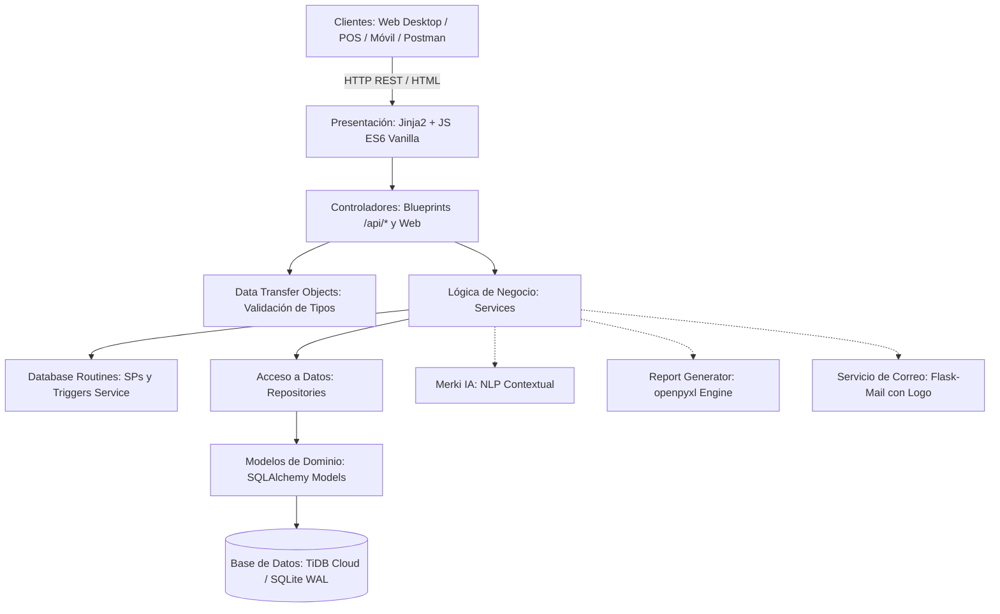

# MANUAL TÉCNICO DE ARQUITECTURA Y DESARROLLO — MercAPP POS
**Sistema Inteligente de Punto de Venta, Gestión de Inventario y Relación B2B/B2C**

---

## 1. Ficha Técnica y Stack Tecnológico

- **Nombre del Sistema:** MercAPP POS (Point of Sale & Retail Management System)
- **Versión:** 2.0.0 (Enterprise Academic Release)
- **Despliegue Activo en Producción:** [https://mercapp-deploy.onrender.com](https://mercapp-deploy.onrender.com)
- **Arquitectura de Software:** Monolito Modular Desacoplado por Capas (N-Tier Architecture: Presentation, Controllers, DTOs, Services, Repositories, Domain Models) con soporte Híbrido Web & Desktop.
- **Lenguaje Principal:** Python 3.11+ / Python 3.14
- **Framework Web Backend:** Flask 3.0+
- **ORM & Capa de Persistencia:** SQLAlchemy 2.0+ con Flask-SQLAlchemy (sintaxis moderna `db.session.get()`).
- **Motores de Base de Datos Soportados:**
  - *Producción Cloud:* TiDB Cloud Serverless (MySQL 8.0 Protocol compatible con escalado horizontal).
  - *Local Standalone:* SQLite 3 en modo concurrente Write-Ahead Logging (WAL) y PRAGMAs optimizados de caché.
- **Servidor Web WSGI:** Waitress (multihilo de alto rendimiento para entornos desktop/locales) y Gunicorn (entornos Linux/Cloud).
- **Seguridad & Autenticación:**
  - *Sesión Web Stateful:* Flask-Login con cookies `HttpOnly`, `SameSite=Lax` y firma HMAC.
  - *API Stateless JWT:* PyJWT 2.8+ con tokens Bearer firmados con clave simétrica SHA-256 e interceptor `@app.before_request`.
  - *Protección CSRF:* `CSRFProtect` global (Flask-WTF). Las llamadas por sesión web requieren `X-CSRFToken`; las llamadas autenticadas vía Bearer JWT quedan exentas dinámicamente al no depender de cookies de navegador.
  - *Políticas CORS:* `flask-cors` configurado restrictivamente: no refleja orígenes arbitrarios con credenciales (`supports_credentials=False` cuando origen es comodín).
  - *Control de Tasa (Rate Limiting):* Módulo propietario en memoria (`utilities/rate_limiter.py`) con algoritmo de ventana deslizante (Sliding Window Log) y exclusión mutua mediante `threading.Lock` para mitigar ataques de fuerza bruta.
  - *Cabeceras de Seguridad:* Middleware HTTP con `Content-Security-Policy (CSP)`, `X-Content-Type-Options: nosniff`, `X-Frame-Options: SAMEORIGIN`, `X-XSS-Protection` y `Referrer-Policy`.
- **Frontend:** HTML5 semántico, Jinja2, CSS3 con temas dinámicos (Dark/Light), JavaScript ES6+ asíncrono con Fetch API, Bootstrap 5.3 y JsBarcode.
- **Inteligencia Artificial:** Asistente conversacional multi-tenant "Merki" (`services/merki_service.py` y `services/merki_queries.py`) con procesamiento de lenguaje natural en español para consultas analíticas instantáneas.

---

## 2. Arquitectura de Software por Capas (N-Tier)

### 2.1. Desglose de Capas

1. **Controladores (`controllers/`):** Desacoplados mediante Flask Blueprints (`user_controller.py`, `product_controller.py`, `sale_controller.py`, `merki_controller.py`). Gestionan validación de entrada, códigos de estado HTTP (200, 201, 400, 401, 403, 404, 500) y delegación limpia.
2. **Data Transfer Objects (`dtos/`):** Clases inmutables con validación preventiva (`user_dto.py`, `product_dto.py`, `sale_dto.py`) para evitar ataques de asignación masiva.
3. **Servicios (`services/`):** Núcleo de las reglas de negocio (cálculo de arqueos, deducción de inventario, políticas de crédito, algoritmos NLP).
4. **Repositorios (`repositories/`):** Abstracción de acceso a base de datos utilizando el estándar moderno SQLAlchemy 2.0 (`db.session.get()`).
5. **Modelos de Dominio (`models/`):** 28 entidades relacionales con restricciones de clave foránea e índices compuestos.
6. **Utilidades y Seguridad (`utilities/`):** Sanitizador de URLs anti-open redirect (`security.py`), generador de reportes ejecutivos en Excel con context managers (`report_generator.py`), respaldo en caliente (`backup_service.py`) y rate limiter.

---

## 3. Modelo de Datos — Catálogo Oficial de 28 Tablas

El esquema relacional de MercAPP consta de **exactamente 28 tablas** divididas en 5 submódulos de dominio:

| Submódulo | Tablas Relacionales (28 en total) | Propósito en el Dominio |
| :--- | :--- | :--- |
| **1. Núcleo y Administración** | `tienda`, `usuario`, `configuracion_tienda`, `app_license`, `auditoria` | Control multi-tenant, cuentas de personal, preferencias visuales, licenciamiento y trazabilidad. |
| **2. Catálogo e Inventario** | `categoria`, `subcategoria`, `producto` | Jerarquía de productos, precios enteros, pesaje en báscula (`sell_by_weight`), stock y códigos de barras. |
| **3. POS y Operación de Caja** | `sesion_caja`, `venta`, `detalle_venta` | Turnos de cajeros, arqueo ciego, comprobantes de pago (efectivo, tarjeta, transferencia) e ítems vendidos. |
| **4. Fiados y Créditos** | `cliente_credito`, `venta_credito`, `pago_credito` | Libreta digital de clientes, seguimiento de saldo adeudado, historial de abonos y control de morosidad. |
| **5. Portal Clientes & B2B Proveedores** | `cliente`, `verificacion_email_cliente`, `pedido`, `detalle_pedido`, `notificacion_pedido`, `proveedor`, `verificacion_email_proveedor`, `orden_compra`, `orden_compra_item`, `factura_proveedor`, `entrega_proveedor`, `verificacion_email`, `recuperacion_contrasena`, `cola_correos` | Registro y compras online de clientes, aprovisionamiento B2B de proveedores, facturas digitales, cola asíncrona de correos y códigos de verificación. |

---

## 4. Matriz CRUD de Permisos por Rol

Para cumplir con el **Criterio B** de la evaluación académica, el sistema implementa una matriz estricta de control de acceso basada en roles (RBAC):

| Entidad / Recurso | Rol Administrador | Rol Cajero | Rol Cliente (`Customer`) | Rol Proveedor (`Supplier`) |
| :--- | :---: | :---: | :---: | :---: |
| **Productos e Inventario** | **CRUD** (Total) | **R** (Solo Lectura) | **R** (Solo Catálogo Activo) | **R** (Catálogo de Reposición) |
| **Categorías** | **CRUD** | **R** | **R** | **-** (Sin Acceso) |
| **Ventas POS** | **CRUD** (Anulación/Reporte) | **CR** (Crear y Consultar Turno) | **-** | **-** |
| **Sesiones de Caja (Turnos)** | **CRUD** (Apertura y Cierre) | **CR** (Apertura y Arqueo Propio) | **-** | **-** |
| **Clientes y Fiados** | **CRUD** (Cupos y Abonos) | **CR** (Venta Fiada y Cobro) | **-** | **-** |
| **Pedidos en Línea** | **RU** (Despacho / Estado) | **R** (Consulta de Pedidos) | **CR** (Crear y Ver Propios) | **-** |
| **Órdenes de Proveedor** | **CRUD** (Aprobación y Pago) | **-** | **-** | **RU** (Entrega y Factura) |
| **Usuarios y Cajeros** | **CRUD** (Crear y Bloquear) | **-** | **-** | **-** |
| **Auditoría y Reportes Excel** | **R** (Exportación Ejecutiva) | **-** | **-** | **-** |

*Convención: C = Create (Crear), R = Read (Leer), U = Update (Actualizar), D = Delete (Eliminar).*

---

## 5. Procedimientos Almacenados y Triggers (Arquitectura Híbrida)

### 5.1. Definición Formal en MySQL 8.0+ (`database/stored_procedures_triggers.sql`)
1. **`sp_registrar_venta_pos`:** Ejecuta venta y descuento de stock atómicamente con `START TRANSACTION` y `SELECT ... FOR UPDATE`.
2. **`sp_cerrar_turno_caja`:** Compara recuento ciego (`actual_cash`) con el balance del sistema calculando faltantes y sobrantes.
3. **`sp_reporte_ventas_diarias`:** Agrupa ventas por categoría, ingresos y unidades vendidas en una fecha.
4. **`sp_abonar_deuda_cliente`:** Aplica pagos a las facturas fiadas más antiguas y actualiza a `PAGADA` al saldar balance.
5. **`sp_reorden_stock_minimo`:** Detecta artículos cuyo stock es menor o igual al umbral mínimo para reorden.
6. **5 Triggers Nativos:** `trg_auditoria_cambio_precio`, `trg_evitar_stock_negativo`, `trg_auditoria_nueva_venta`, `trg_actualizar_saldo_credito`, `trg_auditoria_eliminar_usuario`.

### 5.2. Capa de Ejecución y Compatibilidad (`services/database_routines_service.py`)
Dado que bases de datos distribuidas en la nube como **TiDB Cloud Serverless** y motores embebidos como **SQLite WAL** delegan las rutinas procedimentales a la capa de cómputo para maximizar el throughput sin bloqueos de red, MercAPP implementa la capa homóloga en Python `DatabaseRoutinesService`. Esto permite que la misma lógica empresarial sea ejecutada y probada mediante la suite de tests automatizados (`test_services.py`), garantizando portabilidad 100% entre SQLite, TiDB y MySQL.

---

## 6. Seguridad y Mitigación de Vulnerabilidades

1. **Autenticación y Bloqueo Temporal (15 Minutos):** Campo `locked_until` en la tabla `usuario`. Tras 5 intentos fallidos, el usuario queda suspendido por 15 minutos; transcurrido este lapso, el sistema realiza auto-desbloqueo seguro.
2. **Defensa contra Open Redirect:** Función centralizada `sanitize_next_url(target, fallback)` en `utilities/security.py`, que valida el host y descarta esquemas externos o prefijos `//`.
3. **CORS Seguro:** Configurado en `app.py` sin reflejar credenciales para orígenes comodín (`supports_credentials=False`).
4. **Content-Security-Policy (CSP):** Cabecera activa en `@app.after_request` restringiendo la inyección de scripts externos.
5. **Protección CSRF:** Exención controlada únicamente para clientes con token Bearer JWT validado criptográficamente en el encabezado `Authorization`.
6. **Manejo de Context Managers:** Uso riguroso de bloques `with sqlite3.connect(...)` e `io.BytesIO()` en servicios de respaldo y exportación Excel.

---

## 7. Integración Continua (CI Pipeline)

Configurada en `.github/workflows/ci.yml`:
- **Disparadores:** Commits y Pull Requests hacia `main` y `develop`.
- **Matriz de Entornos:** Python 3.11 y Python 3.12 en runners Ubuntu.
- **Suite de Pruebas:** Ejecuta los 37 casos de prueba sobre controladores, servicios, modelos y utilidades.
- **Gate de Calidad:** Falla automáticamente la compilación si la cobertura desciende del 68% (`--cov-fail-under=68`), garantizando que ningún código defectuoso llegue a producción.
