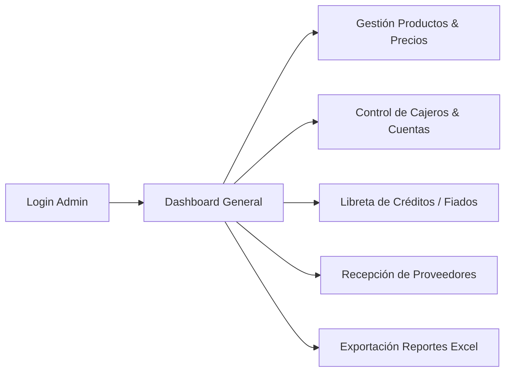
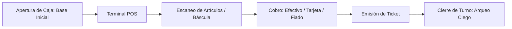

# MANUAL DE USUARIO — MercAPP POS
**Guía Operativa Integral para los 4 Roles del Sistema con Capturas de Pantalla y Matriz CRUD**

---

## 1. Introducción y Acceso al Sistema

MercAPP es una plataforma integral de gestión para tiendas de abarrotes, minimercados y supermercados independientes. Ofrece una experiencia moderna, rápida e intuitiva que conecta el punto de venta (POS) físico con la administración, los pedidos en línea de los clientes y el aprovisionamiento de proveedores.

### 1.1. URLs de Acceso Principal (Producción en Vivo)
- **Portal Administrativo y POS (Admin / Cajero):** [https://mercapp-deploy.onrender.com/login](https://mercapp-deploy.onrender.com/login)
- **Portal de Clientes (Catálogo y Pedidos Online):** [https://mercapp-deploy.onrender.com/customer/login](https://mercapp-deploy.onrender.com/customer/login)
- **Portal de Proveedores (Órdenes y Entregas B2B):** [https://mercapp-deploy.onrender.com/proveedor/login](https://mercapp-deploy.onrender.com/proveedor/login)
- **Descarga Software Escritorio Windows:** [https://mercapp-deploy.onrender.com/descargar-pos](https://mercapp-deploy.onrender.com/descargar-pos)
- **Entorno Local de Desarrollo:** `http://localhost:5000/login`

---

## 2. Matriz Exhaustiva de Permisos y Operaciones CRUD por Rol

> **Convención:** **C** = Crear (Create), **R** = Leer / Consultar (Read), **U** = Actualizar / Modificar (Update), **D** = Eliminar (Delete), **—** = Sin Acceso.

| Módulo / Entidad del Sistema | Rol 1: Administrador | Rol 2: Cajero | Rol 3: Cliente Digital | Rol 4: Proveedor |
| :--- | :---: | :---: | :---: | :---: |
| **Usuarios y Cajeros (`usuario`)** | **CRUD** (Total) | **R** (Solo perfil propio) | — | — |
| **Configuración y Datos Fiscales (`configuracion_tienda`)** | **CRUD** (DIAN, logo, ticket) | **R** (Lectura de ticket) | — | — |
| **Catálogo de Productos (`producto`, `categoria`)** | **CRUD** (Total + Costos) | **R** (Búsqueda y escáner) | **R** (Catálogo web) | **R** (Productos que surte) |
| **Sesiones y Turnos de Caja (`sesion_caja`)** | **R** (Historial + Arqueos) | **CR** (Apertura y Cierre) | — | — |
| **Ventas y Facturación (`venta`, `detalle_venta`)** | **R + U** (Auditar y Anular) | **CR** (Cobro y Emisión) | **R** (Recibo si compró web) | — |
| **Clientes y Fiados (`cliente_credito`, `venta_credito`)** | **CRUD** (Asignar cupo) | **R + C** (Venta a fiado) | — | — |
| **Abonos a Deuda (`pago_credito`)** | **CR** (Registrar y recibo) | **CR** (Registrar abono) | **R** (Historial de abonos) | — |
| **Proveedores y Despachos (`proveedor`)** | **CRUD** (Total) | — | — | **RU** (Perfil y contacto) |
| **Órdenes de Compra (`orden_compra`)** | **CRUD** (Emitir órdenes) | — | — | **RU** (Aceptar y confirmar) |
| **Entregas de Mercancía (`entrega_proveedor`)** | **RU** (Aprobar y pagar caja) | **R** (Verificación física) | — | **CR** (Registrar entrega) |
| **Pedidos en Línea Storefront (`pedido`, `detalle_pedido`)** | **RU** (Despachar y facturar) | **R** (Alistamiento en tienda)| **CRUD** (Crear y rastrear) | — |
| **Auditoría de Seguridad (`auditoria`)** | **R** (Bitácora inmutable) | — | — | — |
| **Reportes Ejecutivos Excel (.xlsx)** | **R** (Exportar Ventas/Stock) | — | — | — |
| **Asistente Virtual Merki (IA)** | **Total** (Finanzas y caja) | **Operativo** (Turno actual)| — | — |

---

## 3. Rol 1: Administrador de Tienda (Control Total)

El Administrador gobierna todo el ciclo operativo, inventario, finanzas, personal y seguridad del supermercado.

### 3.1. Gestión de Productos y Precios
1. Ingrese a **Productos** desde la barra lateral.
2. Presione `+ Nuevo Producto` y complete los campos requeridos:
   - Nombre comercial y categoría.
   - Precio de venta en COP.
   - Modalidad: **Por Unidad** (código de barras) o **Por Peso** (báscula digital en kg/g).
   - Stock disponible y umbral de alerta mínima.
3. **Auditoría Automática de Precios:** Si modifica el precio de un artículo, el sistema registra inmediatamente el cambio en la tabla inmutable `auditoria`, indicando usuario, fecha, precio anterior y precio nuevo.

### 3.2. Gestión de Personal y Seguridad de Cuentas
1. Diríjase a **Configuración > Cajeros**.
2. Registre cajeros con su correo y contraseña inicial.
3. **Bloqueo Temporal de 15 Minutos:** Si se detectan 5 intentos fallidos consecutivos de inicio de sesión, el sistema suspende la cuenta durante **15 minutos exactos** mediante la columna `locked_until`, desbloqueándola automáticamente al expirar el tiempo.

### 3.3. Libreta Digital de Fiados (Clientes de Crédito)
1. Ingrese a **Clientes de Crédito**.
2. Cree o edite clientes asignando un cupo máximo de endeudamiento.
3. Consulte el historial de ventas pendientes y registre abonos parciales o totales. El sistema descuenta los saldos mediante algoritmo FIFO (primero en vencer, primero en saldar) y emite el comprobante de pago.

### 3.4. Exportación de Reportes Financieros en Excel (.xlsx)
Desde el panel de reportes, descargue con un solo clic:
- **Reporte de Ventas:** Relación de transacciones con desglose por medio de pago (efectivo, tarjeta, transferencia), cajero, ticket y fórmulas `SUM()` automáticas.
- **Reporte de Inventario:** Catálogo valorizado con semáforo de existencias (Óptimo, Bajo, Crítico).

---

## 4. Rol 2: Operador de Caja (Cajero)

Interfaz de alto rendimiento optimizada para teclado, pantalla táctil y lector láser de códigos de barras.

### 4.1. Apertura de Turno
1. Inicie sesión en `/login`.
2. Ingrese la **Base Inicial de Caja** (dinero en efectivo entregado para dar cambio).
3. Se desbloquea la cuadrícula de venta interactiva.

### 4.2. Registro de Ventas y Cobro
1. **Agregar Productos:** Pistolee con lector de código de barras o use el buscador predictivo.
2. **Productos por Peso:** Al seleccionar un ítem de báscula (frutas, verduras, carnes), el sistema captura los gramos y calcula el valor exacto.
3. **Cobro:**
   - **Efectivo:** Ingrese el valor entregado; el sistema calcula la devuelta en tipografía de alto contraste.
   - **Tarjeta / Transferencia:** Registre el código de aprobación.
   - **Fiado:** Seleccione el cliente de crédito autorizado.
4. Presione **Cobrar e Imprimir** para emitir el ticket.

### 4.3. Cierre de Turno y Arqueo Ciego
1. Al finalizar la jornada, presione **Cerrar Turno**.
2. Realice el **Arqueo Ciego**: cuente el efectivo real en gaveta e ingréselo sin ver el saldo teórico.
3. El sistema calcula la diferencia (sobrante o faltante), genera el reporte y envía un correo consolidado automático al administrador.

---

## 5. Rol 3: Cliente Digital (Storefront Web)

Canal de autoservicio para clientes del barrio que realizan compras y pedidos a domicilio desde su celular o computador.

1. **Catálogo Virtual:** Ingrese a [https://mercapp-deploy.onrender.com/tienda](https://mercapp-deploy.onrender.com/tienda) sin necesidad de app externa.
2. **Carrito de Compras:** Agregue productos con precios sincronizados en tiempo real con la tienda física.
3. **Envío del Pedido:** Ingrese nombre, dirección y medio de pago previsto (contra entrega en efectivo o transferencia bancaria).
4. **Seguimiento en Vivo:** Reciba notificaciones sobre el estado del pedido: *Pendiente → En Preparación → En Camino → Entregado*.

---

## 6. Rol 4: Proveedor Mayorista (Portal B2B)

Permite a las distribuidoras y preventistas gestionar entregas de mercancía directamente a la tienda.

1. **Acceso al Portal:** Ingrese a [https://mercapp-deploy.onrender.com/proveedor/login](https://mercapp-deploy.onrender.com/proveedor/login).
2. **Registro de Despacho:** Al llegar al supermercado, el despachador registra el número de factura/remisión, el monto total y los bultos entregados.
3. **Pago en Caja:** Si el pago se realiza con efectivo de caja, el monto queda descontado automáticamente del arqueo de caja del turno activo.
4. **Historial de Facturas:** Consulta de saldos por cobrar, facturas pendientes y órdenes de compra recibidas.
