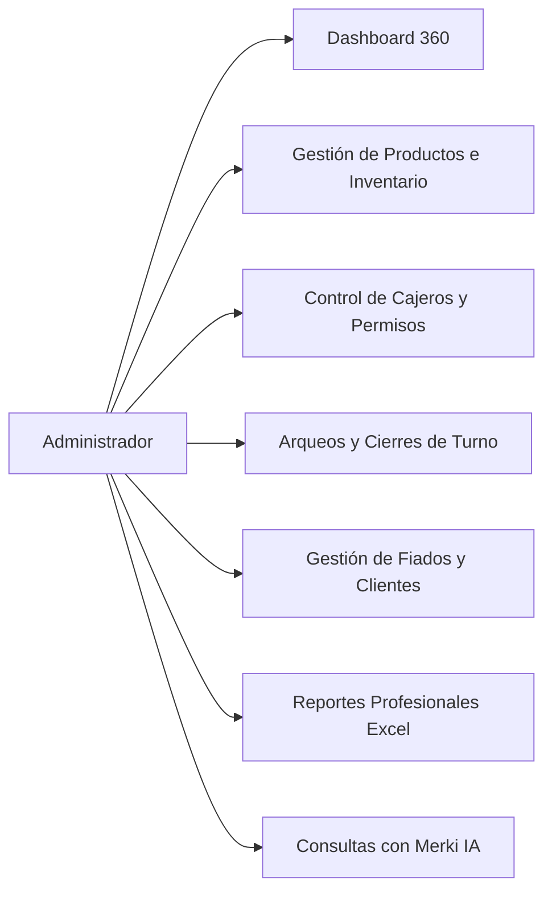

# MANUAL DE USUARIO — MercAPP POS
**Guía Operativa Integral para los 4 Roles del Sistema**

---

## 1. Introducción y Acceso al Sistema

MercAPP es una plataforma integral de gestión para tiendas de abarrotes, minimercados y supermercados independientes. Ofrece una experiencia moderna, rápida e intuitiva que conecta el punto de venta (POS) físico con la gestión administrativa, los pedidos en línea de los clientes y el abastecimiento de proveedores.

### 1.1. URLs de Acceso Principal
- **Portal Administrativo y POS (Admin / Cajero):** `http://localhost:5000/login` o `https://mercapp-pos.onrender.com/login`
- **Portal de Clientes (Catálogo y Pedidos Online):** `http://localhost:5000/customer/login`
- **Portal de Proveedores (Órdenes y Entregas B2B):** `http://localhost:5000/proveedor/login`

---

## 2. Rol 1: Administrador de Tienda

El Administrador tiene control total sobre las operaciones, el personal, los inventarios, la tesorería y la configuración del negocio.

### 2.1. Gestión de Productos y Precios
1. Ingrese al menú lateral y seleccione **Productos**.
2. **Nuevo Producto:** Haga clic en el botón `+ Nuevo Producto`.
   - Ingrese el nombre comercial del artículo.
   - Seleccione la categoría correspondiente.
   - Ingrese el precio de venta al público en pesos colombianos ($ COP).
   - Defina el tipo de venta: **Por Unidad** o **Por Peso (Báscula)** indicando si se comercializa en kilogramos o gramos.
   - Escanee o asigne un **Código de Barras** único.
   - Establezca el stock disponible y el nivel de **Stock Mínimo** para reorden.
3. **Modificación y Auditoría:** Al cambiar el precio de un producto, el sistema genera automáticamente un registro en el módulo de auditoría indicando fecha, usuario responsable, precio anterior y precio nuevo.

### 2.2. Gestión de Cajeros y Personal
1. Diríjase a **Configuración > Cajeros**.
2. Para dar de alta a un cajero, ingrese su nombre, correo electrónico y contraseña temporal.
3. El administrador puede activar o desactivar cajeros en cualquier momento.
4. **Seguridad de cuentas:** Si un cajero ingresa 5 contraseñas erróneas consecutivas, el sistema bloquea preventivamente su acceso durante 15 minutos para proteger el punto de venta contra ataques de fuerza bruta.

### 2.3. Control de Deudas y Clientes de Crédito (Fiados)
1. Ingrese a **Clientes de Crédito**.
2. Registre los datos del cliente: Nombre completo, teléfono, dirección y **Cupo Máximo Autorizado** de crédito.
3. Desde esta pantalla puede:
   - Consultar el historial detallado de compras fiadas.
   - Registrar **Abonos Parciales o Totales** en efectivo o transferencia.
   - Bloquear clientes morosos o que hayan superado el cupo permitido.

### 2.4. Descarga de Reportes Ejecutivos en Excel (.xlsx)
1. En la barra superior o sección de reportes, seleccione:
   - **Reporte de Ventas en Excel:** Descarga un archivo con formato institucional, paleta esmeralda, desglosado por recibo, método de pago, cajero y fórmulas de totalización automática.
   - **Reporte de Inventario en Excel:** Descarga la relación valorizada de todo el inventario activo clasificado por categoría.

### 2.5. Asistente con Inteligencia Artificial "Merki"
1. Haga clic en el botón flotante de **Merki** en la esquina inferior del sistema.
2. Escriba preguntas en lenguaje natural como:
   - *"¿Cuánto vendí hoy?"*
   - *"¿Cómo está la caja en este turno?"*
   - *"¿Qué productos están por agotarse?"*
   - *"¿Quién me debe más dinero en fiados?"*
   - *"¿Cuáles son los productos más vendidos?"*
3. Merki analiza instantáneamente las tablas de la tienda y responde con resúmenes ejecutivos claros.

---

## 3. Rol 2: Operador de Caja (Cajero)

El perfil del Cajero está diseñado para operar con máxima velocidad y sin distracciones, permitiendo atender clientes de forma fluida tanto con teclado físico como con pantalla táctil.

### 3.1. Apertura de Turno de Caja
1. Al iniciar la jornada, el cajero inicia sesión con sus credenciales.
2. El sistema solicita obligatoriamente el **Monto Base de Apertura** (efectivo con el que arranca la gaveta para dar cambio).
3. Una vez confirmada la base, se habilita la pantalla del POS.

### 3.2. Proceso de Venta en el POS
1. **Agregar Productos al Carrito:**
   - **Por Escáner:** Pistolee el código de barras del producto; se agregará instantáneamente al carrito.
   - **Por Búsqueda Rápida:** Escriba las primeras letras del producto o presione sobre su tarjeta visual.
   - **Productos por Peso (Báscula):** Si el producto se vende por peso (ej. frutas, verduras, carnes), el sistema solicitará el peso en kilogramos o gramos y calculará el precio exacto proporcional.
2. **Métodos de Pago:**
   - **Efectivo:** Ingrese el monto entregado por el cliente; el sistema mostrará en números grandes el cambio o vuelto exacto a devolver.
   - **Tarjeta / Transferencia:** Registre la confirmación del datáfono o comprobante.
   - **Crédito / Fiado:** Seleccione el cliente registrado en la libreta digital; el sistema validará que la venta no exceda su cupo disponible.
3. **Comprobante de Venta:** Al confirmar, se genera el comprobante digital y se envía la orden de apertura a la gaveta de dinero.

### 3.3. Cierre de Turno y Arqueo Ciego
1. Al finalizar el turno, presione **Cerrar Turno**.
2. **Arqueo Ciego:** El cajero ingresa el recuento físico del dinero en gaveta sin que el sistema le revele el total teórico esperado (evitando manipulaciones).
3. El sistema registra el cierre y emite el resumen consolidado para el administrador.

---

## 4. Rol 3: Cliente Digital (`Customer`)

Permite a los vecinos y clientes habituales consultar el catálogo de su tienda de barrio y realizar pedidos a domicilio o para recoger en tienda.

### 4.1. Registro y Verificación
1. Ingrese a `/customer/login` y seleccione **Crear Cuenta**.
2. Ingrese su nombre, correo electrónico y contraseña.
3. El sistema envía un correo con un código de verificación de 6 dígitos para validar la identidad del usuario.

### 4.2. Catálogo y Pedidos Online
1. Inicie sesión para ver los productos disponibles con precios actualizados y fotos.
2. Agregue los productos deseados al carrito virtual.
3. Seleccione el tipo de entrega (Recoger en tienda o Domicilio) e ingrese observaciones (ej. *"los plátanos que no estén muy maduros"*).
4. Confirme el pedido. Podrá seguir el estado en tiempo real:
   - `PENDIENTE` ➔ `EN PREPARACIÓN` ➔ `LISTO PARA ENTREGA` ➔ `ENTREGADO`.

---

## 5. Rol 4: Proveedor de Mercancía (`Supplier`)

Canal B2B que digitaliza la relación con los distribuidores y surtidores de mercancía.

### 5.1. Acceso al Portal de Proveedores
1. Ingrese a `/proveedor/login`.
2. Si es un nuevo proveedor, regístrese indicando razón social, NIT/Cédula, correo y teléfono de contacto.

### 5.2. Gestión de Entregas y Facturación
1. **Ver Órdenes de Compra:** Consulte las solicitudes de mercancía generadas automáticamente por las tiendas cuando su stock baja del mínimo.
2. **Registrar Entrega:** Cuando el transportador o repartidor llega al establecimiento:
   - Selecciona la tienda receptora.
   - Ingresa los productos entregados y las cantidades verificadas.
   - Carga la foto o PDF de la **Factura Digital**.
   - Si la entrega incluye cobro en efectivo, registra el monto cobrado; el sistema requerirá la aprobación expresa del administrador de la tienda para asentar la salida de caja.
3. **Historial de Pagos:** Consulta de facturas canceladas, pendientes de pago y recibos de entrega emitidos.
